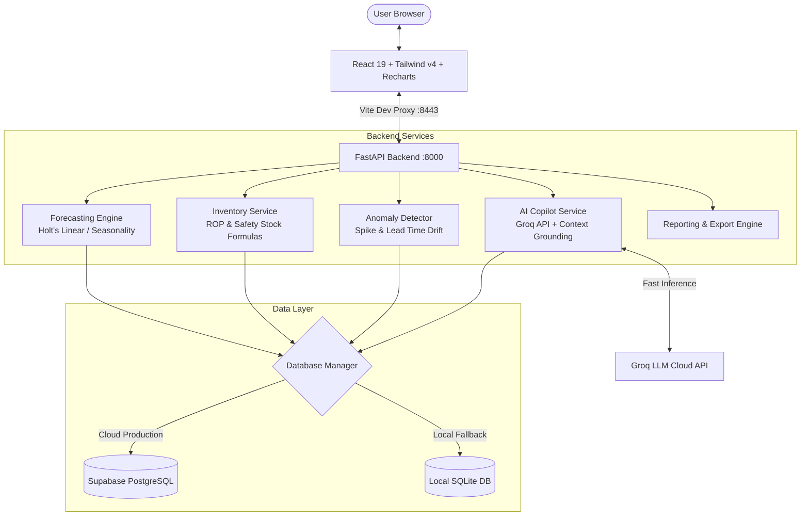

# 📦 DemandAI (v2.0) — Intelligent Demand Forecasting & Supply Chain Optimization

[](https://react.dev/)
[](https://www.typescriptlang.org/)
[](https://tailwindcss.com/)
[](https://vitejs.dev/)
[](https://fastapi.tiangolo.com/)
[](https://www.python.org/)
[](https://supabase.com/)
[](https://groq.com/)
[](LICENSE)

**DemandAI v2** is an enterprise-grade AI demand forecasting, autonomous inventory replenishment, and supply chain anomaly detection system. It combines statistical time-series forecasting (Holt-Winters double/triple exponential smoothing with seasonal decomposition), dynamic multi-echelon safety stock modeling, real-time anomaly detection, and a conversational AI Copilot powered by **Groq ultra-fast LLM inference** and **Supabase Cloud PostgreSQL**.

---

## 🌟 Key Highlights & Features

### 1. 📈 Predictive Demand Forecasting Engine
* **Holt's Linear & Exponential Smoothing**: Models level, trend, and cyclical seasonality with adaptive smoothing coefficients ($\alpha = 0.35, \beta = 0.15$).
* **95% Confidence / Prediction Envelopes**: Dynamically scales uncertainty intervals over multi-step horizons ($1.96 \cdot \sigma_e \cdot \sqrt{h}$).
* **Multi-Horizon Planning**: Real-time projection across **7-day**, **30-day**, and **90-day** outlooks.
* **Accuracy Metrics**: Historical tracking with **MAPE** (Mean Absolute Percentage Error, ~4.2%) and **RMSE** (Root Mean Squared Error).

### 2. 🛡️ Autonomous Inventory Optimization & Replenishment
* **Dynamic Safety Stock Calculation**: Adapts based on lead time and demand variance:
  $$SS = Z \cdot \sigma_d \cdot \sqrt{L}$$
* **Intelligent Reorder Point (ROP)**: Automatically calculates reorder trigger thresholds:
  $$ROP = (d \cdot L) + SS$$
* **Days of Supply (DOS) Monitoring**: Real-time burn-rate tracking to flag items approaching critical stockout risk.
* **Automated Purchase Orders (PO)**: Generate and record purchase orders with automated cost calculations and status tracking.

### 3. 🚨 Supply Chain Anomaly Detection & Triage
* **Multi-Vector Threat Detection**: Identifies demand surges, sudden sales drop-offs, supplier lead time expansions, holding cost overstocks, and model drift.
* **Impact Quantification**: Immediate calculation of revenue at risk and daily accrued holding penalties.
* **Interactive Workflow**: Acknowledge alerts, view diagnostic summaries, and mark anomalies as resolved.

### 4. 🤖 DemandAI Copilot (Groq LLM + Live Context)
* **Grounded Supply Chain Intelligence**: Powered by Groq's high-speed inference engine (`openai/gpt-oss-120b`, `qwen/qwen3.8-27b`, `groq/compound`).
* **Live Catalog & Anomaly Injection**: Queries real-time inventory levels, stockout risks, and active anomalies directly from the database into prompt context.
* **Deterministic Rule-Based Fallback**: Built-in algorithmic fallback ensures intelligent answers even when offline or without an API key.

### 5. 🗄️ Dual-Database Architecture (SQLite + Supabase Cloud)
* **Zero-Setup Local SQLite**: Out-of-the-box local database with auto-seeding for development and testing.
* **Cloud Supabase PostgreSQL**: Automatic detection and transparent failover/synchronization when `SUPABASE_URL` and `SUPABASE_KEY` are provided.
* **Cloud Schema Included**: Full DDL schema script in `backend/supabase_schema.sql` with sample seeds.

### 6. 🎨 Modern Executive Interface
* **Built with React 19 & Tailwind CSS v4**: Ultra-responsive layout with sleek glassmorphism styling.
* **Rich Visualizations**: Interactive line charts, area charts, bar charts, and radar charts powered by Recharts.
* **Dark Mode & Density Controls**: Native dark theme toggle and layout density switcher (*Compact*, *Standard*, *Comfortable*).
* **Exportable Reports**: Generates and simulates PDF, XLSX, and CSV downloads for executive reporting.

---

## 🏛️ System Architecture



---

## 📂 Project Structure

```
demand-forcasting-vesion-2/
├── backend/                        # Python FastAPI Backend
│   ├── main.py                     # App entry point, CORS, and router registry
│   ├── database.py                 # Dual DB abstraction (Supabase client + SQLite fallback)
│   ├── models.py                   # Pydantic models for requests & responses
│   ├── supabase_schema.sql         # Supabase PostgreSQL schema script & initial seed
│   ├── routers/                    # REST API endpoints
│   │   ├── dashboard.py            # KPI metrics and high-level summaries
│   │   ├── forecast.py             # Demand projections & confidence bounds
│   │   ├── inventory.py            # SKU catalog, stock updates & PO reordering
│   │   ├── anomalies.py            # Anomaly list & resolution endpoints
│   │   ├── reports.py              # Report generation and export handling
│   │   ├── assistant.py            # AI Copilot chat query endpoint
│   │   └── settings.py             # System & integration settings
│   └── services/                   # Business logic and forecasting algorithms
│       ├── forecasting.py          # Holt's linear smoothing & time-series models
│       ├── inventory_service.py    # Safety stock, ROP, and PO logic
│       ├── anomaly_service.py      # Outlier detection and alert triggers
│       └── assistant_service.py    # Groq LLM integration & supply chain reasoning
├── src/                            # React Frontend
│   ├── App.tsx                     # Main application UI, dashboard, and views
│   ├── main.tsx                    # React DOM entry point
│   ├── index.css                   # Tailwind CSS v4 styling & dark theme variables
│   └── services/
│       └── api.ts                  # Type-safe API client for backend communication
├── .env.example                    # Template for environment configuration
├── requirements.txt                # Python backend dependencies
├── package.json                    # Node dependencies and npm/pnpm scripts
├── tsconfig.json                   # TypeScript configuration
├── vite.config.ts                  # Vite build and proxy configuration
└── README.md                       # Repository documentation
```

---

## 🚀 Quickstart Guide

### Prerequisites
* **Node.js**: v18.0.0 or higher
* **pnpm** (preferred) or **npm**
* **Python**: 3.10 or higher
* **Git**

---

### Step 1: Clone the Repository
```bash
git clone https://github.com/rangithkumarpathyam-collab/demand-forcasting-vesion-2.git
cd demand-forcasting-vesion-2
```

---

### Step 2: Configure Environment Variables
Copy the `.env.example` file to create your local `.env`:

```bash
# On Linux / macOS
cp .env.example .env

# On Windows PowerShell
Copy-Item .env.example .env
```

Open `.env` and configure your credentials. The app works out of the box using SQLite and rule-based fallback even without external API keys, but providing **Groq** and **Supabase** keys enables full cloud capabilities.

---

### Step 3: Backend Setup (Python FastAPI)

1. **Create and activate a virtual environment:**

   ```bash
   # Windows
   python -m venv venv
   .\venv\Scripts\activate

   # Linux / macOS
   python3 -m venv venv
   source venv/bin/activate
   ```

2. **Install Python dependencies:**

   ```bash
   pip install -r requirements.txt
   ```

3. **Start the FastAPI backend server:**

   ```bash
   python -m uvicorn backend.main:app --port 8000 --reload
   ```

   *API documentation will be live at `http://127.0.0.1:8000/docs`.*

---

### Step 4: Frontend Setup (React + Vite)

In a new terminal window:

1. **Install dependencies:**

   ```bash
   pnpm install
   # or: npm install
   ```

2. **Start the Vite development server:**

   ```bash
   pnpm dev
   # or: npm run dev
   ```

3. Open your browser and navigate to:
   **`http://localhost:8443`** *(or the port displayed in your terminal)*.

The Vite development server automatically proxies all `/api/*` requests to the FastAPI backend running on `http://127.0.0.1:8000`.

---

## ⚙️ Environment Variables Reference

| Variable | Description | Default / Example |
| :--- | :--- | :--- |
| `SUPABASE_URL` | Supabase project URL | `https://your-project.supabase.co` |
| `SUPABASE_KEY` | Supabase anon public or service role key | `eyJhbGci...` |
| `GROQ_API_KEY` | Groq Cloud API key for ultra-fast AI inference | `gsk_...` |
| `GEMINI_API_KEY` | Google Gemini API Key (optional LLM alternative) | `AIzaSy...` |
| `OPENAI_API_KEY` | OpenAI API Key (optional LLM alternative) | `sk-...` |
| `HOST` | Backend server host bind address | `127.0.0.1` |
| `PORT` | Backend server port | `8000` |
| `ENVIRONMENT` | Runtime environment (`development` / `production`) | `development` |
| `VITE_API_BASE_URL` | Frontend API client base path | `/api` |
| `VITE_ENABLE_MOCK_FALLBACK` | Fallback to mock data if backend is unreachable | `true` |

---

## ☁️ Supabase Cloud Database Integration

To connect to Supabase PostgreSQL:

1. Create a free project at [supabase.com](https://supabase.com).
2. Open the **SQL Editor** in your Supabase dashboard.
3. Open `backend/supabase_schema.sql` from this repository, paste the entire script into the SQL editor, and click **Run**.
4. Retrieve your **Project URL** and **anon/service_role API key** from **Project Settings > API**.
5. Paste them into your `.env`:
   ```ini
   SUPABASE_URL=https://your-project-ref.supabase.co
   SUPABASE_KEY=your-supabase-key
   ```
6. Restart the FastAPI backend. It will detect the credentials and log:
   ```
   [Database] Primary database: Supabase PostgreSQL (Cloud)
   ```

---

## 📡 REST API Reference

The backend provides complete OpenAPI / Swagger documentation at `http://127.0.0.1:8000/docs`.

### Core Endpoints

| Method | Endpoint | Description |
| :--- | :--- | :--- |
| `GET` | `/api/health` | Health check endpoint returning backend service status |
| `GET` | `/api/dashboard/summary` | Aggregated executive KPIs, sales charts, and urgent restock list |
| `GET` | `/api/forecast?horizon={7d\|30d\|90d}` | Time-series forecast with confidence intervals and trend lines |
| `GET` | `/api/inventory` | Complete SKU catalog with stock, safety stock, ROP, and supply days |
| `POST` | `/api/inventory/reorder` | Create a purchase order (`{ "sku": "...", "quantity": 100 }`) |
| `PATCH` | `/api/inventory/{sku}` | Update SKU parameters (`stock`, `lead_time`, `demand30`) |
| `GET` | `/api/anomalies` | List all active supply chain anomalies and risk factors |
| `PATCH` | `/api/anomalies/{id}/resolve`| Update anomaly status (`open`, `acknowledged`, `resolved`) |
| `POST` | `/api/assistant/chat` | Send queries to DemandAI Copilot (`{ "message": "..." }`) |
| `GET` | `/api/reports` | List generated reports with metadata and statuses |
| `POST` | `/api/reports/generate` | Generate on-demand report (`{ "type": "...", "format": "..." }`) |
| `GET` | `/api/reports/export` | Download raw CSV/Excel report data |
| `GET` | `/api/settings` | Retrieve active supply chain configuration and parameters |
| `POST` | `/api/settings` | Update system preferences and threshold settings |

---

## 📐 Scientific & Mathematical Foundations

### 1. Holt's Linear Exponential Smoothing
Demand forecasting employs double exponential smoothing to capture trend variations over time:

$$\begin{aligned}
L_t &= \alpha Y_t + (1 - \alpha)(L_{t-1} + T_{t-1}) \\
T_t &= \beta (L_t - L_{t-1}) + (1 - \beta) T_{t-1} \\
\hat{Y}_{t+h} &= L_t + h \cdot T_t \cdot S_h
\end{aligned}$$

Where:
* $L_t$: Estimated baseline demand level at period $t$
* $T_t$: Estimated trend slope
* $S_h$: Seasonal multiplier
* $\alpha = 0.35$: Level smoothing parameter
* $\beta = 0.15$: Trend smoothing parameter

### 2. Prediction Interval Modeling
Uncertainty expands with longer forecast horizons $h$:

$$CI_h = \hat{Y}_{t+h} \pm Z \cdot \sigma_e \cdot \sqrt{h}$$

Where $Z = 1.96$ corresponds to a 95% confidence level and $\sigma_e$ is the standard deviation of residuals.

### 3. Safety Stock & Reorder Points
To protect against lead time variability and demand spikes:

$$SS = Z \cdot \sigma_d \cdot \sqrt{L}$$

$$ROP = (d \cdot L) + SS$$

Where:
* $d$: Average daily demand ($\frac{\text{Demand}_{30}}{30}$)
* $L$: Supplier lead time in days
* $\sigma_d$: Daily demand standard deviation ($0.25 \cdot d$)
* $Z$: Service factor ($Z = 1.65$ for 95% service level)

---

## 🛠️ Development & Build Scripts

| Command | Tool | Purpose |
| :--- | :--- | :--- |
| `pnpm dev` | Vite | Start frontend dev server on port 8443 |
| `pnpm backend` | Uvicorn | Start FastAPI backend server on port 8000 |
| `pnpm build` | Vite + TypeScript | Type-check and compile frontend for production |
| `pnpm preview` | Vite | Locally preview production build |
| `pnpm format` | oxfmt | Format TypeScript/CSS codebase |

---

## 🤝 Contributing

Contributions, issues, and feature requests are welcome!
1. Fork the Project
2. Create your Feature Branch (`git checkout -b feature/AmazingFeature`)
3. Commit your Changes (`git commit -m 'Add some AmazingFeature'`)
4. Push to the Branch (`git push origin feature/AmazingFeature`)
5. Open a Pull Request

---

## 📄 License

This project is licensed under the **MIT License** — see the [LICENSE](LICENSE) file for details.
